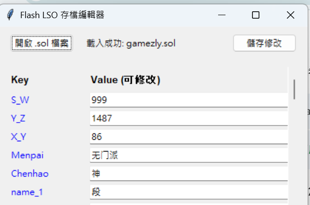

# 童年拯救器 (Childhood Savior)

Flash LSO 存檔編輯器：重溫經典，修改數據。



---

### 項目簡介

這個專案是一個基於 Python 的桌面應用程式，專門用於讀取和修改 Flash 遊戲生成的 **Local Shared Object (LSO)** 存檔文件（通常以 `.sol` 結尾）。LSO 文件是 Flash 遊戲常見儲存進度、金幣或經驗值的方式。

使用者可以瀏覽存檔中所有的 Key-Value 數據，並修改這些數值。

### 安裝與環境要求

本工具基於 Python 3.x 環境。

#### 環境要求

* **Python:** 3以上版本
* **作業系統:** Windows (理論上 Linux/macOS 亦可，但主要針對 Windows 檔案路徑設計)

#### 依賴庫安裝

需要安裝 `pyamf` 庫來處理 LSO 文件的編碼與解碼：

```bash
pip install pyamf
```

### 使用方法

本程式分為兩個步驟：啟動應用程式，以及操作介面。

#### 步驟一：啟動程式

1.  **檔案準備**：將 `sol_editor.py` 和 `sol_app.py` 放在同一個資料夾中。
2.  **啟動**：在該資料夾中開啟命令提示字元或 PowerShell，執行主程式：

    ```bash
    python sol_app.py
    ```

#### 步驟二：介面操作

1.  **開啟存檔**：點擊 GUI 介面上的 **`開啟 .sol 檔案`** 按鈕，選擇想要修改的 Flash 遊戲存檔（例如 `game.sol`）。
2.  **瀏覽數據**：程式會列出存檔中所有的 Key 和對應的 Value。
3.  **進行修改**：可以在 Value 欄位的輸入框中輸入新的數值（例如將 `LV` 從 `29` 改為 `99`）。**注意：** 請確保輸入的數值與旁邊顯示的**類型**相符（例如，整數輸入整數，字串輸入字串）。
4.  **儲存**：點擊 **`儲存修改`** 按鈕。程式將更新 `.sol` 檔案。

### 項目結構

本專案主要由兩個 Python 檔案構成：

| 檔案名稱 | 說明 |
| :--- | :--- |
| `sol_editor.py` | 專案核心。包含 `SOLFile` 類別，封裝了 LSO 文件的讀取、修改、PyAMF 編碼和安全寫入的底層邏輯。 |
| `sol_app.py` | 使用者介面。包含 `SOLEditorApp` 類別，使用 `Tkinter` 框架，負責處理按鈕點擊、檔案選擇和數據顯示。 |